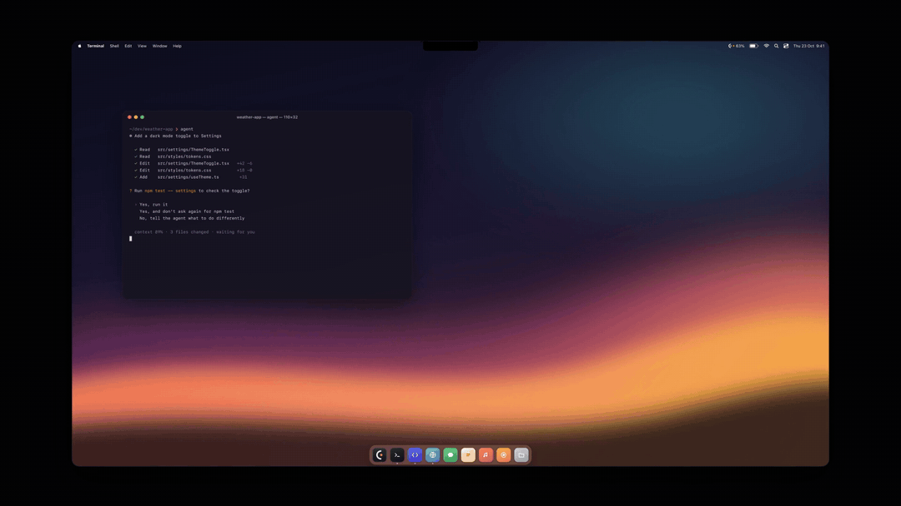
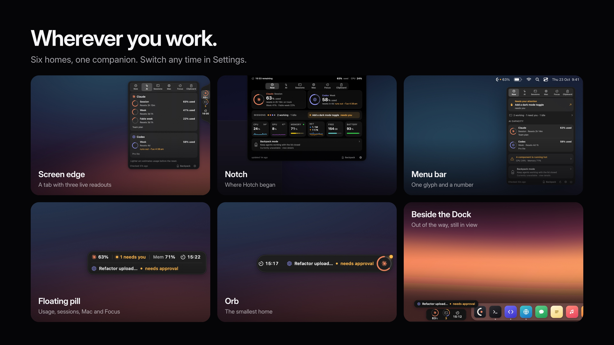
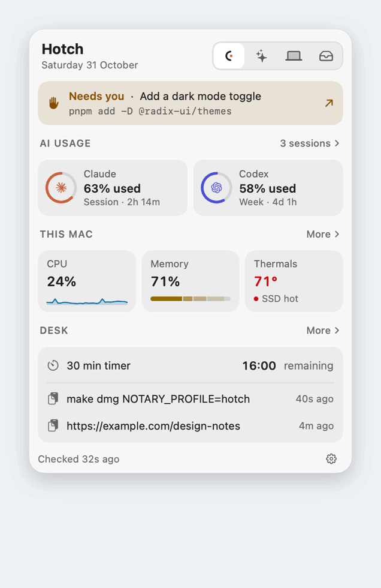
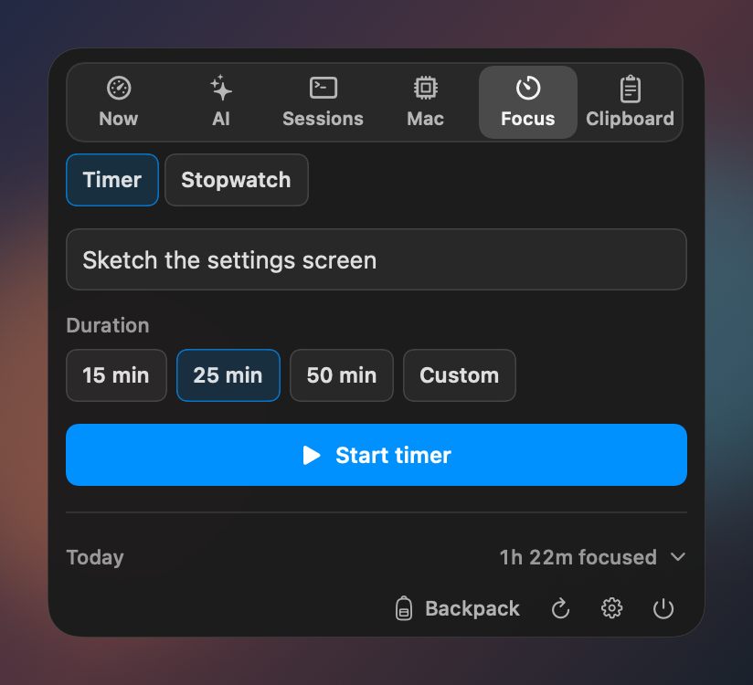
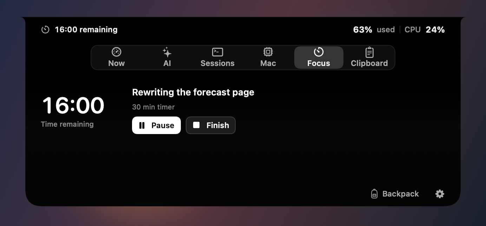

# Hotch

Hotch is a native macOS companion for a glance at AI plan usage, active Claude Code and Codex work, and Mac activity. Keep it on a screen edge, by the Dock, around the notch, floating on your desktop, or in the menu bar. It is built with Swift and SwiftUI, targets macOS 14 or later, and has no third-party package dependencies.

[](docs/marketing/video/hotch-reel.mp4)

Recorded from the real app with demo data. [Watch the full 53-second reel](docs/marketing/video/hotch-reel.mp4), with alerts, the original notch view, and the pill, orb and Dock homes.

**Try it:** [Build from source](#build-from-source) · [Report a bug](https://github.com/hotherside/Hotch/issues/new/choose) · [Contribute](CONTRIBUTING.md)

> **Project status:** Hotch is an independent project and is not affiliated with Apple, Anthropic, OpenAI, xAI, Moonshot AI, or DeepSeek. Provider data and availability depend on vendor accounts and interfaces, which can change.

## Features

- Usage windows for Claude and Codex, plus optional balance or usage sources for Grok, Kimi, and DeepSeek.
- Live Claude Code and Codex session summaries, with a shortcut to bring the related app to the front. This brings forward the app surface; it does not guarantee opening a particular thread.
- CPU, memory, network, disk, battery, process, and optional hardware sensor readings.
- A Focus timer or stopwatch with explicit controls and a persistent clock on your selected companion.
- Discoverable Backpack mode for keeping agents awake with the lid closed, with one-time helper approval and automatic limits.
- Optional in-memory clipboard history and brief alerts.
- A compact three-readout tab on the left, right or bottom, with all six sections inside the card; the original Notch view; floating pill and orb; or menu bar only.




<details>
<summary>Tour all six sections</summary>



Native view snapshots with demo data, one per section, ending on an alert.

</details>

<details>
<summary>Focus and the original Notch view</summary>





</details>

## Install

Hotch is currently available as a [source build](#build-from-source). There is no published app download yet. Packaged downloads will appear on the [Releases page](https://github.com/hotherside/Hotch/releases), with signing and notarization status stated for each release. For an unnotarized local build, macOS may show its normal Gatekeeper warning.

## Build from source

You need a Mac with Swift 6 and the macOS 26 SDK or newer to compile the optional Liquid Glass code. The resulting app runs on macOS 14 or later. Xcode 26.3 is the CI toolchain; matching Command Line Tools can also work. The Makefile prefers a locally installed 26.x SDK to avoid missing SwiftUI macro plugins in some newer CLT installations.

```sh
git clone https://github.com/hotherside/Hotch.git
cd Hotch
make app
```

The app bundle is created at `build/Hotch.app`. `make run` builds it and launches it. `make check` runs the project's build and local validation checks. `make app-universal` builds Apple Silicon and Intel slices and requires a toolchain that can cross-compile both architectures.

## Connect providers

On first launch, a short welcome letter introduces Hotch. One setup screen then helps you choose placement, detects configured providers, and offers optional clipboard history, and Hotch points to where it now lives when you finish. You can replay the welcome from Settings. Open Settings from the Hotch menu bar item or card to configure providers. Claude reads plan usage through Claude Code, which must be installed and signed in. Codex reads usage and thread metadata through the Codex app-server; the Codex app/CLI and a signed-in account are needed. Grok, Kimi, and DeepSeek are optional and require the corresponding vendor API key; Grok also needs a team ID. Provider credentials are sent to their respective vendor to request usage or balance data. These requests do not run model inference.

Data sources and setup details can change with vendor software and account plans. Check the provider's status in Settings if a row cannot connect.

## Privacy and data handling

Hotch is local-first: its settings, usage history, and session summaries are stored on your Mac. To provide live readings, it makes account or billing requests to the configured provider, and launches the installed Claude Code or Codex client where required. Those vendors receive the requests they need to answer. Hotch does not submit prompts for model inference.

Hotch reads local Claude Code and Codex session metadata to show session titles, status, and context usage. Those local logs may contain conversation content; Hotch parses them locally and does not upload transcripts. Provider requests and the vendor clients remain subject to their own privacy policies.

Optional clipboard history stores up to five recent text items in memory only, truncates long text, and skips pasteboard writes marked concealed, transient, or autogenerated. Quitting or disabling the feature clears its in-memory list. Review [Privacy and data handling](SHARING.md) for more detail.

Provider API keys you add are stored as plaintext files restricted to your macOS user, not embedded in the app. Software running as that same user can read them. Apple signing and notarization credentials are maintainer-only build credentials and are not shipped. See the [publication security review](docs/security-review.md) for the scope and findings of the initial audit.

Backpack mode installs a privileged helper only after the user approves it in System Settings. It temporarily changes sleep behavior while active and has battery, thermal, time, and agent-completion guardrails. Optional temperature, fan, and power readings use undocumented Apple sensor interfaces and can vary across Mac models and macOS releases.

## Contribute

See [CONTRIBUTING.md](CONTRIBUTING.md) for setup, checks, and small ways to help. Please read [SECURITY.md](SECURITY.md) before reporting a vulnerability. The project is distributed under the MIT License; see [LICENSE](LICENSE) and [third-party notices](THIRD_PARTY_NOTICES.md).

If Hotch is useful to you, consider starring the repository. Bug reports, documentation improvements, and focused pull requests are welcome.

## Releases

See [RELEASING.md](RELEASING.md) for maintainer release steps. Source builds are available for review; signed, notarized distribution depends on maintainer-owned Apple credentials.
