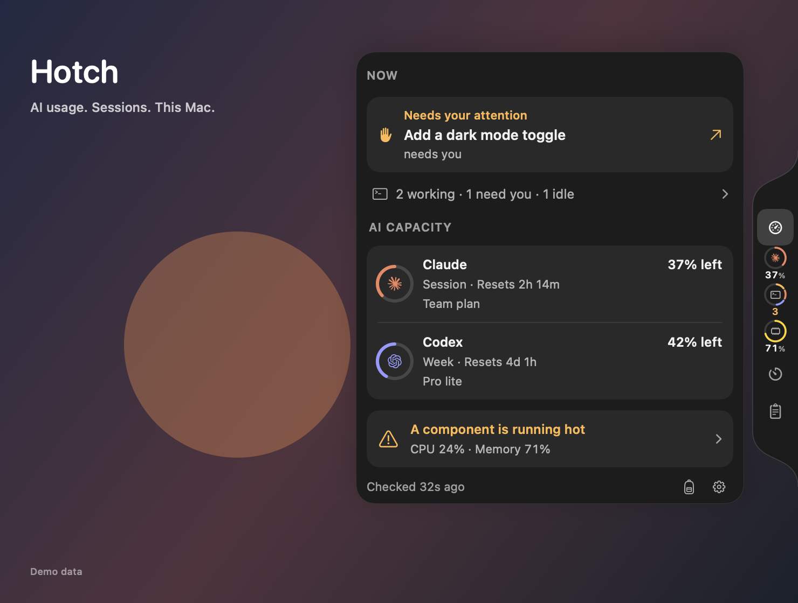
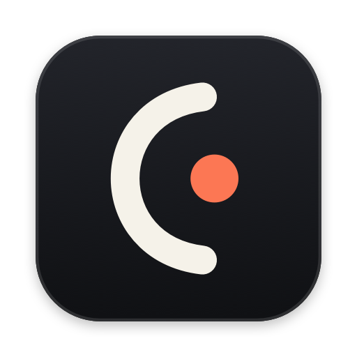
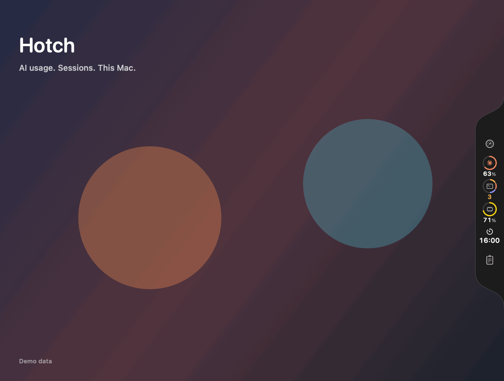

# Hotch

Hotch is a native macOS companion for a glance at AI plan usage, active Claude Code and Codex work, and Mac activity. It lives in the menu bar and can also show a compact edge or floating card. It is built with Swift and SwiftUI, targets macOS 14 or later, and has no third-party package dependencies.

> **Project status:** Hotch is an independent project and is not affiliated with Apple, Anthropic, OpenAI, xAI, Moonshot AI, or DeepSeek. Provider data and availability depend on vendor accounts and interfaces, which can change.



## Features

- Usage windows for Claude and Codex, plus optional balance or usage sources for Grok, Kimi, and DeepSeek.
- Live Claude Code and Codex session summaries, with a shortcut to bring the related app to the front. This brings forward the app surface; it does not guarantee opening a particular thread.
- CPU, memory, network, disk, battery, process, and optional hardware sensor readings.
- Optional in-memory clipboard history, focus timer, alerts, and Backpack mode for keeping work awake with the lid closed.
- Menu-bar, edge-card, and floating-card layouts.



<details>
<summary>Take a 19-second tour</summary>



Native view snapshots with demo data, showing the resting rail, six sections and an alert. This storyboard shows layout; hover timing is best tried in the app.

</details>

## Install

Download a release from the repository's **Releases** page when one is available. Open the DMG and drag `Hotch.app` to Applications. Release signing and notarization status will be stated with each release. For an unnotarized local build, macOS may show its normal Gatekeeper warning.

## Build from source

You need a Mac with Swift 6 and the macOS 26 SDK or newer to compile the optional Liquid Glass code. The resulting app runs on macOS 14 or later. Xcode 26.3 is the CI toolchain; matching Command Line Tools can also work. The Makefile prefers a locally installed 26.x SDK to avoid missing SwiftUI macro plugins in some newer CLT installations.

```sh
# From a local checkout of this repository:
make app
```

The app bundle is created at `build/Hotch.app`. `make run` builds it and launches it. `make check` runs the project's build and local validation checks. `make app-universal` builds Apple Silicon and Intel slices and requires a toolchain that can cross-compile both architectures.

## Connect providers

On first launch, the welcome flow helps you choose placement, detects configured providers, and offers optional clipboard history. You can replay it from Settings. Open Settings from the Hotch menu bar item or card to configure providers. Claude reads plan usage through Claude Code, which must be installed and signed in. Codex reads usage and thread metadata through the Codex app-server; the Codex app/CLI and a signed-in account are needed. Grok, Kimi, and DeepSeek are optional and require the corresponding vendor API key; Grok also needs a team ID. Provider credentials are sent to their respective vendor to request usage or balance data. These requests do not run model inference.

Data sources and setup details can change with vendor software and account plans. Check the provider's status in Settings if a row cannot connect.

## Privacy and data handling

Hotch is local-first: its settings, usage history, and session summaries are stored on your Mac. To provide live readings, it makes account or billing requests to the configured provider, and launches the installed Claude Code or Codex client where required. Those vendors receive the requests they need to answer. Hotch does not submit prompts for model inference.

Hotch reads local Claude Code and Codex session metadata to show session titles, status, and context usage. Those local logs may contain conversation content; Hotch parses them locally and does not upload transcripts. Provider requests and the vendor clients remain subject to their own privacy policies.

Optional clipboard history stores up to five recent text items in memory only, truncates long text, and skips pasteboard writes marked concealed, transient, or autogenerated. Quitting or disabling the feature clears its in-memory list. Review [Privacy and data handling](SHARING.md) for more detail.

Backpack mode installs a privileged helper only after the user approves it in System Settings. It temporarily changes sleep behavior while active and has battery, thermal, time, and agent-completion guardrails. Optional temperature, fan, and power readings use undocumented Apple sensor interfaces and can vary across Mac models and macOS releases.

## Contribute

See [CONTRIBUTING.md](CONTRIBUTING.md) for setup, checks, and small ways to help. Please read [SECURITY.md](SECURITY.md) before reporting a vulnerability. The project is distributed under the MIT License; see [LICENSE](LICENSE) and [third-party notices](THIRD_PARTY_NOTICES.md).

## Releases

See [RELEASING.md](RELEASING.md) for maintainer release steps. Source builds are available for review; signed, notarized distribution depends on maintainer-owned Apple credentials.
