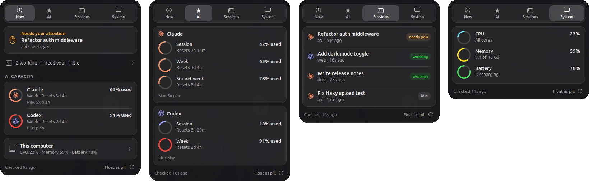
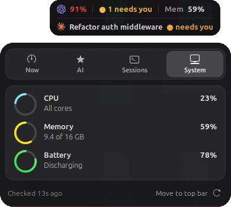

# Hotch for Linux (experimental)

Linux uses a separate Rust binary and GNOME Shell frontend. The macOS SwiftUI app is unchanged. The GNOME extension provides the same four-tab card as the Mac, with Settings in the footer. Other desktops use a simpler tray and the CLI.

## The card

The tabs are icons on the right of the card's header; the open page's name and a one-line caption sit on the left of the same row.

| Tab | Shows | Caption |
|---|---|---|
| **Hotch** (home) | A "Needs you" line for each session waiting on input (at most two, only while one waits), AI usage tiles, CPU / memory / battery tiles, a one-click Focus start (15, 25 or 50 minutes, or a stopwatch) and the last two clipboard items. Each block leads to its tab. | Today's date |
| **AI** | Each provider's usage windows, with that provider's Claude Code or Codex sessions nested underneath. | What the sessions are doing, amber when one needs you |
| **Computer** | CPU, memory and battery. The same tab is called Mac on macOS. | A memory, CPU or battery warning, else how often it updates |
| **Desk** | Focus (timer or stopwatch, task name, custom duration) and clipboard history. | The running Focus clock, else what Desk holds |

Linux reads no temperatures, so home's third computer tile is the battery where the Mac shows thermals; desktops without a battery show two tiles. Sessions show their status, project and age; the Linux backend does not read tool calls, so there is no current-step line.

## Feature support

| Feature | GNOME Shell 48–50 | Other Linux desktops |
|---|---|---|
| Claude / Codex usage, resets and plan names | Yes | Tray and CLI |
| Codex approval/input state | When reported by the local app-server | Same backend |
| Four-tab card (Hotch, AI, Computer, Desk) | Yes | No; the tray menu lists the readings |
| Settings and provider controls | Settings page and CLI | CLI |
| Homes | Top bar, pill, orb, left/right/bottom edge | Tray |
| Light/dark/system appearance | Yes | Desktop-controlled tray menu |
| Used/remaining display; refresh cadence | Yes | Shared preferences |
| Focus timer / stopwatch | One-click start from home; current run, pause/resume and persistence on Desk | Not yet |
| Clipboard history | Optional, five text entries in memory; last two on home | Not yet |
| CPU, memory, battery | Home tiles and Computer tab | Tray and CLI |
| Update notice (links only; never installs) | Footer line and Settings | Tray menu and CLI |
| Focus task history / daily totals; session host handoff; session current step | Not yet | Not yet |
| Grok, Kimi, DeepSeek; network/disk/process/GPU/temperature sensors | Not yet | Not yet |
| macOS notch / Dock / Backpack integration | Unavailable | Unavailable |

Screen edges are compact readouts on the primary monitor. Pill and orb can be dragged across monitors and remember their position. These are Linux placements using GNOME widgets, rather than exact replicas of every macOS interaction. There is no standalone GTK app window on other desktops.

The original screenshots below show the initial port with demo data. They predate the four-tab card, Settings, additional homes, Focus and Clipboard:





## Install

Use the experimental Linux assets attached to a release, when available. Existing macOS-only releases do not contain these packages. Replace `VERSION` below with the downloaded version, choose `amd64` or `arm64` for your machine, and verify the file against `SHA256SUMS-linux.txt` before installing:

```sh
sudo apt install ./hotch_VERSION-1_amd64.deb
# Log out and back in so Wayland loads the new extension, then:
gnome-extensions enable hotch@hotherside.com
```

The package installs the binary, GNOME extension and a tray launcher. It does not autostart the tray, which would duplicate the GNOME frontend. The extension starts at login while enabled. Ubuntu 24.04 or newer is the binary baseline; its default GNOME 46 does not support this extension, so use the tray or a desktop with GNOME 48–50.

The `hotch-gnome-VERSION.zip` download can alternatively be installed with `gnome-extensions install --force ./hotch-gnome-VERSION.zip`. It still requires the matching `hotch` binary in `/usr/bin` or `~/.local/bin`.

### From source

Use a current Rust toolchain from [rustup](https://rustup.rs). The distribution `cargo` on older Ubuntu releases may be too old for the D-Bus dependency. Node.js 24+ is used for development tests, not required at runtime.

```sh
git clone https://github.com/hotherside/Hotch.git
cd Hotch/linux
cargo build --release --locked
install -Dm755 target/release/hotch ~/.local/bin/hotch
install -Dm644 ../docs/marketing/brand/app-icon.png ~/.local/share/icons/hicolor/512x512/apps/hotch.png
install -Dm644 hotch.desktop ~/.local/share/applications/hotch.desktop
```

For the full GNOME frontend:

```sh
mkdir -p ~/.local/share/gnome-shell/extensions
cp -r gnome-extension ~/.local/share/gnome-shell/extensions/hotch@hotherside.com
# Log out and back in on Wayland, then:
gnome-extensions enable hotch@hotherside.com
```

For the tray on KDE, Xfce, Cinnamon, waybar, or GNOME without the Hotch extension:

```sh
install -Dm644 hotch.desktop ~/.config/autostart/hotch.desktop
hotch &
```

Ubuntu's AppIndicator extension supports the tray. Stock GNOME generally needs “AppIndicator and KStatusNotifierItem Support”; KDE and the other listed tray hosts have their own support.

## Settings and local tools

Open the gear button in the GNOME card footer. Settings provides all six homes, system/light/dark appearance, used/remaining percentages, 30-second/1/2/5-minute refresh, provider toggles, the clipboard opt-in and update checks.

Preferences are shared with the tray and CLI in `$XDG_CONFIG_HOME/hotch/gnome.json` (default `~/.config/hotch/gnome.json`). Existing pill positions migrate in place. CLI edits reload in GNOME; tray changes apply at its next refresh or after its Refresh action:

```sh
hotch settings
hotch settings set displayMode remaining
hotch settings set refreshSeconds 120
hotch settings set providers '["claude","codex"]'
hotch settings set providers '[]'  # local tools only; no provider reads
```

Focus lives on the Desk tab, and home starts a 15, 25 or 50 minute timer or a stopwatch in one click. It has explicit Timer and Stopwatch modes, preset or custom durations, a task name, pause/resume/reset, a clock on the active companion, and one completion notification. Current timer state persists across GNOME restarts; task history and daily totals are not yet ported.

Clipboard history is off by default and starts with future copies when enabled, on the Desk tab or in Settings. It retains at most five text entries in memory, each capped at 20,000 characters; Desk lists them all and home the last two. Select an entry to copy it again. Disabling, stopping the extension or logging out clears the history. Hotch skips supplied password-manager, concealed, transient and autogenerated MIME markers before reading text. Applications do not always supply such markers; unmarked sensitive text cannot be recognised automatically. Clipboard contents are never saved in settings or sent to a provider.

## Update notice

Hotch tells you when a newer Linux release is out. It never downloads or installs anything: you stay in control of what runs on your machine.

At most once a day, the GNOME extension's regular refresh or the tray asks GitHub's public releases API (`api.github.com/repos/hotherside/Hotch/releases`) for the newest Linux release, using `curl`, or `wget` where curl is missing. The request sends the Hotch version in its User-Agent; as with any HTTPS request, GitHub also sees your IP address. Nothing about your accounts, usage or sessions is sent. A failed daily check (offline, rate-limited) shows nothing and is retried an hour later; **Check now** in Settings and `hotch update-check` say when they could not check. Each attempt is recorded before asking, so the extension, tray and CLI never ask at once. If the cache cannot be written, the daily check stays off, while `hotch update-check` still works.

A newer release adds a quiet "Hotch X.Y.Z is available" line to the GNOME card footer and an item to the tray menu. Both open the release page; **Skip this version** hides that release until a newer one appears. Download the `.deb` for your architecture there and install it as above. Only releases that change Linux count: a macOS-only release has no `.deb`, so it is never offered.

Turn checks off under Updates in Settings, or from a terminal:

```sh
hotch settings set updateChecks false
hotch update-check                     # ask now, even with daily checks off
hotch settings set updateSkipped ''    # offer a skipped release again
```

The last check time and result are cached in `$XDG_CACHE_HOME/hotch/update.json` (default `~/.cache/hotch/update.json`); deleting it only brings the next check forward.

## Providers and session freshness

- **Claude** needs Claude Code installed and signed in (`claude` on `PATH`, `~/.local/bin` or `~/.claude/local`). Sign in with `claude auth login` in a terminal. Usage uses its `get_usage` request.
- **Codex** needs the Codex CLI installed and signed in (`codex login`). Usage uses `codex app-server`.

Disabled providers are not launched or scanned. These are account-metering and local metadata reads; no model prompt is submitted. No provider credential is stored by the Linux port.

Codex session status uses the local app-server's `thread/list`, including approval/input flags when available. A separate server may report a thread as `notLoaded`; the rollout fallback is less precise. Recently modified rollouts are found across dated directories, including older resumed threads. Local transcript parsing stays on the machine; only session titles, project and status summaries reach the frontend.

A failed usage update shows the provider error alongside the last successful reading, preserves that reading's timestamp, and expires cached usage after two hours. The JSON API always reports percentage **used**; display preferences affect the human-readable CLI, tray and GNOME UI.

## CLI and development

```sh
hotch usage
hotch sessions
hotch system
hotch all --json
hotch settings --json
hotch update-check --json
```

Usage, sessions and settings commands also build on macOS for parser and protocol testing. System readings and the tray require Linux.

```sh
python3 tools/check_version.py
cargo fmt --check
cargo clippy --locked --all-targets -- -D warnings
cargo test --locked
cargo build --release --locked
node --check gnome-extension/extension.js
node --test tests/*.test.mjs
cargo install cargo-deb --locked
cargo deb --no-build
python3 tools/package_extension.py
```

Tests use synthetic data and fake vendor CLIs. Extension lifecycle tests use GNOME API doubles and do not verify actual rendering. The Debian package and extension ZIP include all frontend modules; release versions are checked against macOS sources and the release tag. See [RELEASING.md](../RELEASING.md) for release automation.

### Desktop validation

Before release or approval of a UI change, validate on GNOME 48–50 with Wayland:

1. Open all four tabs and Settings; check the header title and caption on each, and that Settings leaves no tab selected. Scroll the long Settings, AI and Desk pages on a small display. With a session waiting for input, check home's "Needs you" line and the amber AI caption; check it disappears once the session moves on.
2. Switch through every home and back to the top bar repeatedly; verify the card survives, edge anchoring, drag/save, monitor disconnect and fullscreen behavior.
3. Check light, dark and system appearance, keyboard focus, readable percentages and used/remaining mode. Critical warnings must still reflect high usage.
4. Change preferences with the UI and CLI, restart GNOME and verify persistence. Disable a provider and confirm its reads and rows stop.
5. Start each Focus preset and the stopwatch from home; start/pause/resume/reset both modes on Desk; restart GNOME mid-run and confirm one completion notification. Type a task name on Desk, copy text and toggle clipboard history: the name must survive.
6. Enable clipboard history with synthetic text; test copy-back, limits, clear, disable and the supplied privacy-marker fixtures. Confirm no clipboard text is written to disk.
7. Check live provider sign-in/error recovery with an authorised test account; screenshots must use demo data. Install the built package on the matching architecture.

For nested-shell screenshots, the development preview opens each tab and Settings and saves `<prefix>-<tab>.png` (`home`, `ai`, `computer`, `desk`, `settings`):

```sh
HOTCH_PREVIEW=/tmp/hotch dbus-run-session -- gnome-shell --devkit --wayland
```

The Rust parsers mirror `Sources/Hotch/Providers/ClaudeCodeBridge.swift`, `CodexAppServer.swift` and `SessionMonitor.swift`; update both implementations when vendor shapes change. The tray label currently uses a pinned `ksni` fork for Ubuntu's Ayatana label extension; remove the patch after a compatible upstream release is available.
