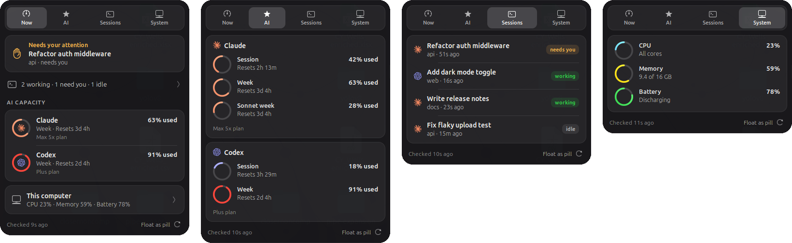
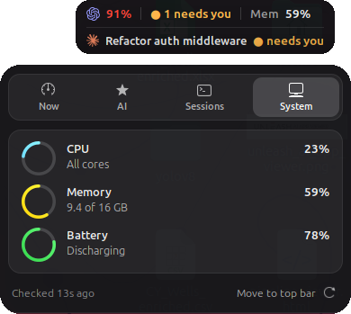

# Hotch for Linux (experimental)

Hotch for Ubuntu and other Linux desktops: a GNOME top-bar panel, a tray icon and a CLI. It shows the same Claude and Codex plan usage and live agent sessions as the macOS app, plus CPU, memory and battery. It is a single Rust binary (about 2 MB, about 6 MB of memory while running), separate from the Swift app: nothing in this folder changes the macOS build.

Two front ends share the binary:

- **GNOME Shell extension** (Ubuntu, Fedora, any GNOME 48 or later). This is the full Hotch panel in the top bar: a usage ring and percentage, and a dark card with Now, AI, Sessions and System tabs, drawn with the same colours, rings and brand marks as the macOS app. It runs `hotch all --json` once a minute.
- **Tray icon** (KDE, Xfce, Cinnamon, waybar, or GNOME without the extension). A ring that fills with the fullest session window and turns red from 90%, the percentage beside it where the host supports labels, and a plain menu with the same data.





Screenshots use demo data, on Ubuntu 26.04 with GNOME Shell 50.

## Install

On Ubuntu or Debian, the simplest route is the `.deb` (from the release page, or build it with `cargo deb` as below):

```sh
sudo apt install ./hotch_2.2.0-1_amd64.deb
# log out and back in (Wayland loads new extensions at login), then:
gnome-extensions enable hotch@hotherside.com
```

It installs `hotch`, the GNOME extension for every user, and a "Hotch" launcher for the tray icon on other desktops.

### From source

You need a current Rust toolchain from [rustup](https://rustup.rs). The `cargo` package in Ubuntu 24.04 is too old for the D-Bus dependency.

```sh
git clone https://github.com/hotherside/Hotch.git
cd Hotch/linux
cargo build --release
install -Dm755 target/release/hotch ~/.local/bin/hotch
install -Dm644 ../docs/marketing/brand/app-icon.png ~/.local/share/icons/hicolor/512x512/apps/hotch.png
install -Dm644 hotch.desktop ~/.local/share/applications/hotch.desktop
```

Then either the GNOME extension:

```sh
mkdir -p ~/.local/share/gnome-shell/extensions
cp -r gnome-extension ~/.local/share/gnome-shell/extensions/hotch@hotherside.com
# log out and back in (Wayland loads new extensions at login), then:
gnome-extensions enable hotch@hotherside.com
```

or the tray icon, started now and at login:

```sh
install -Dm644 hotch.desktop ~/.config/autostart/hotch.desktop
hotch &
```

On Ubuntu the tray uses the AppIndicator extension, which is enabled by default. On stock GNOME (Fedora, Debian), install and enable "AppIndicator and KStatusNotifierItem Support". KDE, Xfce, Cinnamon, and waybar's tray module support it natively.

## Providers

- **Claude**: needs Claude Code installed and signed in (`claude` on the `PATH`, `~/.local/bin` or `~/.claude/local`). Usage comes from Claude Code's own `get_usage` request, as on macOS.
- **Codex**: needs the Codex CLI installed and signed in. Usage comes from `codex app-server`.

These are account metering reads. They do not run model inference. Session titles and states are read locally from `~/.claude` and `~/.codex`, and transcript text never leaves the parser.

Grok, Kimi and DeepSeek balances, Focus, clipboard history, Backpack and the notch/edge views are macOS only for now.

## CLI

```sh
hotch usage      # plan usage per provider
hotch sessions   # live Claude Code and Codex sessions
hotch system     # CPU, memory, battery
hotch all --json # everything, for scripts and status bars
```

`hotch usage` and `hotch sessions` also build on macOS (`cargo run -- usage`), which is handy for checking parity with the app.

## Develop

```sh
cargo test && cargo clippy --all-targets -- -D warnings && cargo fmt --check
```

To work on the extension without logging out, run it in a nested shell (`sudo apt install mutter-dev-bin`). With `HOTCH_PREVIEW` set, the extension opens each tab and saves a screenshot to `<prefix>-<tab>.png`:

```sh
HOTCH_PREVIEW=/tmp/hotch dbus-run-session -- gnome-shell --devkit --wayland
```

`cargo install cargo-deb && cargo deb` builds the package into `target/debian/`.

The parsers mirror `Sources/Hotch/Providers/ClaudeCodeBridge.swift`, `CodexAppServer.swift` and `SessionMonitor.swift`. When a vendor changes a shape there, update both.
